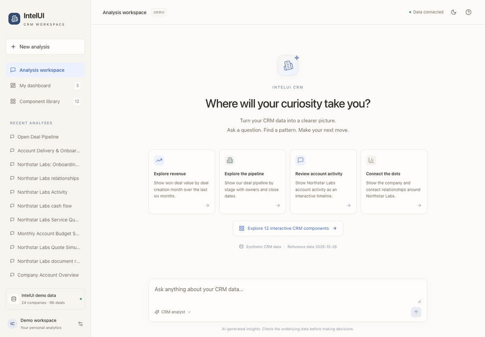
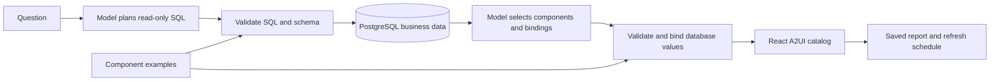

# IntelUI — Intelligence Studio

A conversational analytics system for exploring business data through intelligent interfaces. Explore synthetic business data through conversation, use twelve interactive React components, and save reports that refresh from PostgreSQL.

<p align="center">
  
  
  
  
  
</p>

React + TypeScript · FastAPI · PostgreSQL · CopilotKit A2UI

## Demo



Two live analytics queries, interactive quote adjustments, and a tour of the component library in the default light theme. Model waiting time is shortened.

## Run

Requires Docker with Compose. If you do not already have a root `.env`:

```sh
cp .env.example .env
```

Then start the app:

```sh
docker compose up -d --build
```

Open **[localhost:5188](http://localhost:5188)** and select **Component library**. All twelve examples run real read-only SQL and work without a model key. **Open as report** brings an example into a conversation, where it can be saved to the dashboard.

For natural-language analysis, set `OPENAI_API_KEY` in the root `.env` and recreate the backend:

```sh
docker compose up -d --force-recreate backend
```

The backend runs migrations and seeds missing demo records automatically. API docs are at [localhost:8018/docs](http://localhost:8018/docs); PostgreSQL is exposed on localhost:55432. Existing database/volume names and legacy airline reports are retained during upgrades. The active workspace and model schema use the synthetic business dataset.

## Component catalog

| Component | Interaction |
| --- | --- |
| Account overview | Search companies, filter status, inspect ownership and recorded value |
| Work checklist | Filter tasks and save status changes with an audit entry |
| Document review | Compare declared/extracted fields with source text and save review status |
| Quote simulator | Adjust seats, term, and discount; compare with the saved subscription quote |
| Budget planner | Adjust monthly income, expenses, and additional spend |
| Option comparison | Select service options and compare total contract values |
| Cash-flow explorer | Filter monthly inflows/outflows and inspect source entries |
| Activity timeline | Filter and expand calls, emails, meetings, and notes |
| Business-rule checks | Inspect recorded observations, thresholds, versions, and deterministic results |
| Relationship explorer | Select companies/contacts, inspect connections, and zoom the graph |
| Delivery milestones | Select an account and track completion, owners, dates, and blockers |
| Deal pipeline | Filter by owner, inspect stage totals, and open individual deal details |

The existing KPI cards, bar/line/donut charts, sortable tables, and narrative sections remain available. Components render through the official `@copilotkit/a2ui-renderer` with an allowlisted catalog. The model selects components and column bindings; the server supplies their values from actual query results. No generated JavaScript is executed.

Try these questions:

- “Show our deal pipeline by stage with owners and close dates.”
- “Review the declared and extracted document fields for Northstar Labs.”
- “Build an interactive quote simulator for Northstar Labs.”
- “Show the company and contact relationships around Northstar Labs.”
- “Show won deal value by deal creation month over the last six months.”

## Synthetic data

The initial data batch has **1,814 connected records**: 24 companies, 72 contacts, 8 staff, 96 deals, 288 tasks, 96 documents, 288 document fields, 6 products, 72 quotes, 432 cash entries, 192 activities, 24 company relationships, 96 recorded rule checks, and 120 milestones. Identities use `example.invalid` addresses. All amounts are USD.

Append another complete batch:

```sh
docker compose exec backend python -m app.crm_seed --batch 1
```

Use batch 2, 3, and so on, up to 99, to grow the dataset. Each batch uses distinct IDs and company names. Repeating a batch inserts only missing rows and preserves existing edits. There is no destructive data reset command. Reload component data or refresh saved reports after adding records. Northstar examples intentionally stay focused on the original account; broader account and pipeline views include additional batches within their query limits.

To customize the records, edit [crm_seed.py](backend/app/crm_seed.py) and use a new batch number. Table definitions live in [crm_models.py](backend/app/crm_models.py); schema changes require an Alembic migration.

## Data and actions



Query details expose SQL, returned rows, and model cost when recorded. Reports can be renamed, reordered, removed, and refreshed manually or every 1, 4, 12, or 24 hours. Scheduled refresh requires the backend to remain running. Failed refreshes retain the last successful snapshot. Catalog-example reports refresh without calling a model; AI-generated reports regenerate their presentation from saved SQL.

Task and document-review changes use dedicated backend endpoints, check the displayed record identity and previous status, and write `crm.audit_events`. Mismatched document fields cannot be accepted. Saved report snapshots do not rewrite themselves after an edit; refresh them to see current data. Quote and budget controls are local scenarios and do not modify source records.

## Extend the catalog

1. Build a React component under [frontend/src/crm](frontend/src/crm).
2. Add its strict props schema in [schemas.ts](frontend/src/crm/schemas.ts) and register it in [ReportRenderer.tsx](frontend/src/ReportRenderer.tsx).
3. Add a section kind in [contracts.py](backend/app/contracts.py) and [api.ts](frontend/src/api.ts).
4. Define required column bindings and an example query in [crm_catalog.py](backend/app/crm_catalog.py), then add its library icon in [ComponentLibrary.tsx](frontend/src/ComponentLibrary.tsx).

The model receives the catalog descriptions and binding requirements automatically. Both analysis and saved-report refresh use the same validation and rendering path.

## Checks

Native development requires Node 22.12+ and Python 3.12+ with uv. Start PostgreSQL first. Install backend dependencies with `uv sync --frozen` and frontend dependencies with `npm ci`.

```sh
cd backend
uv run pytest -q
uv run ruff check app migrations tests
uv run ruff format --check app migrations tests
```

For real-database tests, use a disposable migrated and seeded database, set both database URLs, and run with `RUN_DB_TESTS=1`. Initialize the reader role using `database/init.sql`, then run `alembic upgrade head`, `python -m app.seed`, and `python -m app.crm_seed`. The CI workflow does this automatically.

```sh
cd frontend
npm test
npm run lint
npm run format:check
npm run build
```

Live model acceptance is separate and billable; it adds synthetic conversation history:

```sh
docker compose exec backend python -m tests.crm_live_acceptance --base-url http://127.0.0.1:8000
```

Use `--only quote_simulator relationship_graph` for selected checks. Results are written to `/tmp/intelui-crm-live-results.json` inside the container.

Verified locally: 84 backend tests with PostgreSQL, 20 frontend tests, lint/format checks, production builds, all twelve components in Chrome at desktop and phone widths, and twelve live-model requests selecting the expected components. Local verification does not imply a production deployment.

## Scope

- A local single-user demo; no authentication, tenancy, external business-system synchronization, or production permission model. Services bind to localhost.
- Synthetic documents are plain text with seeded extracted fields. PDF upload, OCR, credit checks, and lending workflows are not implemented.
- Business-rule checks use recorded demo observations. They do not provide live compliance assessments or approval decisions.
- Quotes use per-seat monthly pricing, a discount, and a one-time setup fee; taxes are excluded. Budget assumptions are separate from the recorded cash ledger.
- Deal values are contract values, not cash receipts. No actual close date is recorded; date-based deal analysis must identify its creation-date or expected-close basis.
- Results are bounded to 200 rows by default, with additional limits on some example views. Totals describe returned records; ask narrower questions as the dataset grows.
- Each analysis uses one SQL result. Responses arrive as completed reports; token streaming is not implemented. AI-written SQL and prose can still be analytically wrong.

Configuration remains in [.env.example](.env.example). `DEMO_REFERENCE_DATE` defaults to `2026-10-26` for reproducible dates; existing seed batches and saved SQL retain their original dates. `OPENAI_MODEL`, `AI_PROVIDER`, and `OPENAI_BASE_URL` configure the existing Responses-compatible provider. Secrets stay on the backend.
