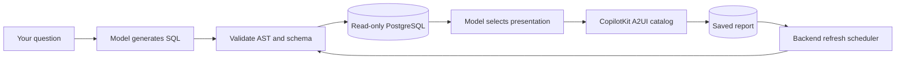

# AeroVista Intelligence

Ask questions about a fictional airline, inspect the generated SQL, and save interactive reports that refresh in the background.

<p align="center">
  
  
  
  
  
</p>

React + TypeScript · FastAPI · PostgreSQL · OpenAI Responses · CopilotKit A2UI

## Run

Requires Docker with Compose. From this directory:

```sh
cp .env.example .env
```

Set `OPENAI_API_KEY` in `.env`, then:

```sh
docker compose up -d --build
```

Open **[localhost:5188](http://localhost:5188)**. The backend runs migrations and seeds the database automatically. [API documentation](http://localhost:8018/docs) and [health](http://localhost:8018/api/health) are available on port 8018. PostgreSQL is exposed locally on 55432. These ports avoid common development-server conflicts.

If `.env` already exists, edit it instead of overwriting it. Secrets stay on the backend and are excluded from Git and frontend builds. After changing model configuration or the key, run `docker compose up -d --force-recreate backend`.

## Try it

- “Show airline revenue by travel class over the last six months.”
- “Which routes generated the highest revenue?”
- “How have flight cancellations changed over the last six months?”
- “Show unresolved complaints associated with business-class passengers.”
- “Generate an executive summary of the airline’s operational performance.”

Follow up in the same conversation, expand **Query details**, or use **Save to dashboard**. On the dashboard you can rename, reorder, delete, refresh, and schedule reports. Intervals are manual, 1, 4, 12, or 24 hours. The backend must remain running for automatic updates; the browser can be closed.

## What runs



The model produces SQL and a typed presentation plan. SQLGlot validates statements, relations, columns, and functions before a separate read-only database login executes them. The model then chooses KPI cards, bar/line/donut charts, tables, and insights. The server binds all displayed data values to actual result rows. CopilotKit's official A2UI renderer renders the resulting document with a controlled React catalog. No arbitrary generated code runs in the browser or database.

Both conversation history and dashboard snapshots live in PostgreSQL. Scheduled jobs use PostgreSQL row locks, so multiple backend workers cannot refresh the same report concurrently. Failed refreshes preserve the last successful report.

The intended framework is [CopilotKit/OpenIntelligentUI](https://github.com/CopilotKit/OpenIntelligentUI), a separate project from GitHub Copilot. This implementation uses its official structured A2UI rendering path, with custom analytics components; it does not reproduce its open-ended JavaScript sandbox or Jev router. See [framework research](docs/intelligent-ui-research.md) and [architecture](docs/architecture.md).

## Configuration

| Setting | Default / purpose |
| --- | --- |
| `OPENAI_API_KEY` | Required for live analysis and refresh |
| `OPENAI_MODEL` | `gpt-6-luna`, verified in [official documentation](https://developers.openai.com/api/docs/models/gpt-6-luna) |
| `AI_PROVIDER` | `openai`; also accepts `openai-compatible` for compatible Responses endpoints |
| `OPENAI_BASE_URL` | `https://api.openai.com/v1` |
| `OPENAI_REASONING_EFFORT` | `medium`; leave blank for providers without this parameter |
| `DEMO_REFERENCE_DATE` | `2026-10-26`; all relative analytical dates use this fixed date |
| `QUERY_TIMEOUT_MS` | 5000 |
| `MAX_RESULT_ROWS` | 200 |
| `AI_TIMEOUT_SECONDS` | 90 per provider call; no automatic transport retries |
| `SCHEDULER_ENABLED` | `true` |
| `SCHEDULER_POLL_SECONDS` | 30 |
| `DATABASE_URL` | Owner connection for application persistence; Compose sets its internal hostname |
| `ANALYTICS_DATABASE_URL` | Separate `airline_reader` login; Compose sets its internal hostname |

Provider integration is isolated in `backend/app/provider.py`. Other API protocols require an adapter. Analysis normally makes two model calls, with at most one SQL repair attempt; refreshing makes one presentation call. These use your API account and can incur charges. Health checks never call the model and cannot confirm model access.

## Dataset and reset

The deterministic seed contains 40 customers, 3 aircraft, 36 flights, 100 bookings, 100 payments, 44 complaints, 49 service requests, and 56 conversations. All identities are synthetic. Completed payments define default net revenue; booking totals are gross value and include refunded/cancelled tickets. All amounts are USD. “Delayed” denotes an arrived flight that departed late. The date range supports six-month trends and the demo's current month.

Safe repeat seed (does nothing once seeded):

```sh
docker compose exec backend python -m app.seed
```

Replace only synthetic airline records, retaining saved reports and conversations:

```sh
docker compose exec backend python -m app.seed --reset
```

Refresh saved reports afterward. To move the demo period, change `DEMO_REFERENCE_DATE`, recreate the backend, and reset the seed. Existing report SQL retains its original reference-date literals; generate new reports for the new period.

To stop without losing data: `docker compose down`. To erase **all demo data and saved reports**, use `docker compose down -v`, then start again.

## Development and checks

Node 22.12+ and Python 3.12+ with uv are required for native development. Start PostgreSQL using `docker compose up -d db`.

Backend, in one terminal:

```sh
cd backend
uv sync --frozen
uv run alembic upgrade head
uv run python -m app.seed
uv run uvicorn app.main:app --reload --port 8018
```

Frontend, in another terminal:

```sh
cd frontend
npm ci
npm run dev
```

Stop Compose's backend/frontend first if using the same ports. The root `.env` is loaded by the native backend. Vite development and preview servers bind to `127.0.0.1`; the development proxy forwards `/api` to 8018.

```sh
cd backend
uv run pytest -q
uv run ruff check app migrations tests
uv run ruff format --check app migrations tests
```

Integration tests use the seeded demo database, create temporary report records, and restore test changes. They mock model calls at the provider boundary and execute real SQL:

```sh
docker compose exec -e RUN_DB_TESTS=1 backend pytest -q -p no:cacheprovider
```

```sh
cd frontend
npm test
npm run lint
npm run format:check
npm run build
```

The [quality workflow](.github/workflows/quality.yml) runs these checks on pushes and pull requests. Its backend job initializes a disposable PostgreSQL 17 database, applies migrations and seed data, and runs all integration tests with mocked model calls. It requires no API key and does not deploy the application. See [validation results](docs/validation.md) for local evidence and remaining limits.

To run all 15 acceptance questions through the **real model** (billable; adds conversation history):

```sh
docker compose exec backend python tests/live_acceptance.py
```

Use `--only 2 5 15` for selected scenarios. Results are written to `/tmp/aerovista-live-results.json` inside the backend container. Automated tests cover seed relationships, SQL rejection/acceptance, schema validation, request bounds, real database permissions, CRUD, changed-data refresh, refresh failures, follow-ups, scheduling, concurrent refresh exclusion, and the actual A2UI renderer.

## Scope and limits

- Single local demo user; no authentication or tenancy. Services bind to localhost.
- Responses arrive as complete reports; token/AG-UI streaming is not implemented.
- Charts use one query result per analysis; a report may show several views of those rows. Use another analysis for unrelated datasets.
- SQL generation and model-written prose can still be analytically wrong. Inspect SQL and data; UI validation prevents unsupported components and invented bound values, not every reasoning mistake.
- SQL and function allowlists are deliberately narrow. Unsupported queries receive a useful error after one repair attempt.
- Schedules are persistent and locked across workers. A crash during a model request can cause that model call to be repeated after restart, though concurrent jobs cannot commit duplicate refreshes.
- Seed data does not change automatically. Refresh reads current PostgreSQL data; it does not manufacture new transactions.
- A fresh page opens a new analysis; previous conversations remain selectable in the sidebar and dashboard reports persist.

See [validation results](docs/validation.md) for the checks actually completed in this checkout.
